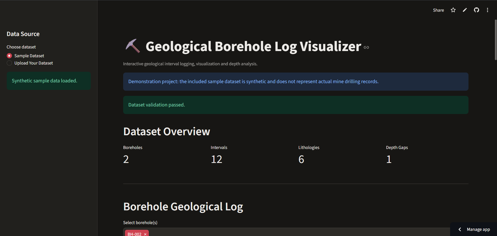
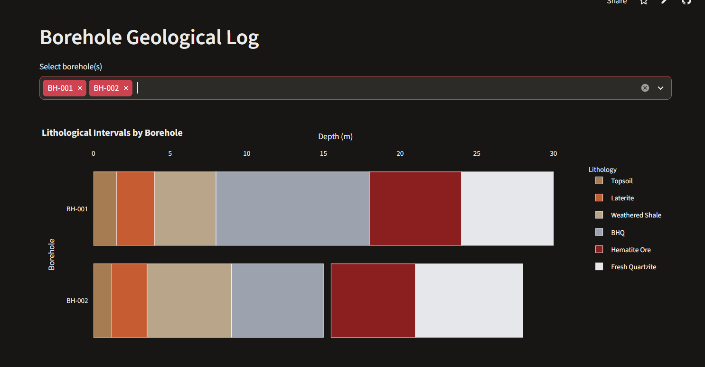
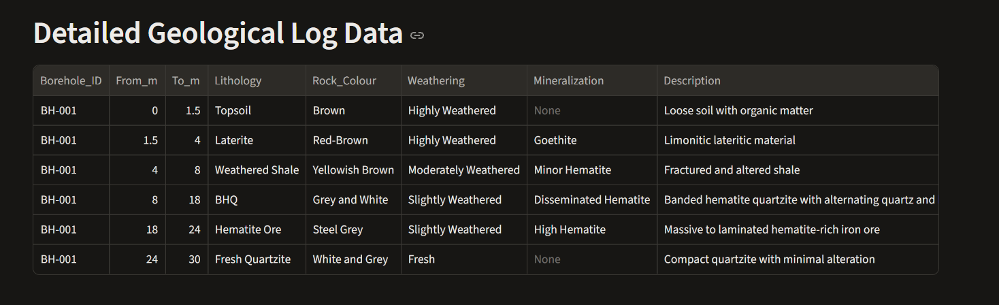
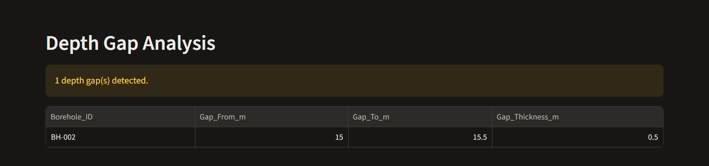

# Geological Borehole Log Visualizer

An interactive Python application for validating, processing, analyzing, and visualizing geological borehole interval data.

Built with **Python, Pandas, Plotly, and Streamlit**.

🌐 **Live Application:** https://geological-borehole-log-visualizer.streamlit.app/

💻 **GitHub Repository:** https://github.com/helldeepak116-design/Geological-Borehole-Log-Visualizer

## Features

- Import borehole data from CSV and Excel files.
- Validate geological interval records.
- Visualize lithological units against numerical depth.
- Compare multiple boreholes interactively.
- Calculate interval thickness automatically.
- Detect overlaps and gaps between consecutive geological intervals.
- Summarize borehole depth and lithological distribution.
- Explore geological attributes through interactive chart tooltips.
- Export processed geological logs as CSV and Excel reports.
- Generate Excel reports containing borehole logs, depth summaries, and depth-gap information.

## Application Screenshots

### Dashboard Overview



### Geological Borehole Log Visualization



### Borehole Log Data



### Depth Gap Analysis



## Technology Stack

| Technology | Purpose |
|---|---|
| Python 3.12 | Core programming language |
| Pandas | Data processing and analysis |
| NumPy | Numerical operations |
| Plotly | Interactive geological visualization |
| Streamlit | Web application framework |
| OpenPyXL | Excel file processing |
| Pytest | Automated testing |

## Project Structure

```text
Geological-Borehole-Log-Visualizer/
│
├── data/
│   └── sample/
│       └── borehole_sample.csv
│
├── docs/
│   └── images/
│
├── outputs/
│
├── src/
│   ├── __init__.py
│   └── borehole.py
│
├── tests/
│   ├── __init__.py
│   └── test_borehole.py
│
├── .github/
│   └── workflows/
│       └── tests.yml
│
├── app.py
├── requirements.txt
├── README.md
└── .gitignore
```

## Installation

Clone the repository:

```bash
git clone https://github.com/helldeepak116-design/Geological-Borehole-Log-Visualizer.git
cd Geological-Borehole-Log-Visualizer
```

Create a virtual environment:

```bash
python -m venv .venv
```

Activate it on Windows:

```powershell
.venv\Scripts\Activate.ps1
```

Install dependencies:

```bash
pip install -r requirements.txt
```

## Run the Application

```bash
streamlit run app.py
```

The application will be available at:

```text
http://localhost:8501
```

## Run Automated Tests

```bash
pytest -v
```

The project currently contains **11 automated tests** covering core functionality, including data validation, interval thickness calculations, overlap detection, and depth-gap identification.

### Continuous Integration

GitHub Actions automatically runs the test suite when changes are pushed to the `main` branch or a pull request targets it.

**CI Status:** Passing

Workflow: `.github/workflows/tests.yml`

[View GitHub Actions](https://github.com/helldeepak116-design/Geological-Borehole-Log-Visualizer/actions)

## Input Data Format

The application requires the following columns:

| Column | Description |
|---|---|
| Borehole_ID | Unique borehole identifier |
| From_m | Starting depth in metres |
| To_m | Ending depth in metres |
| Lithology | Geological rock unit |
| Rock_Colour | Observed rock colour |
| Weathering | Weathering condition |
| Mineralization | Mineralization observations |
| Description | Geological interval description |

## Export Functionality

The application supports exporting processed borehole information in CSV and Excel formats.

The Excel report contains three worksheets:

1. **Borehole_Log** – Processed geological interval records.
2. **Depth_Summary** – Borehole depth summary information.
3. **Depth_Gaps** – Identified gaps between consecutive intervals.

## Geological Applications

The tool demonstrates workflows relevant to:

- Geological and lithological logging.
- Mineral exploration.
- Iron ore exploration.
- Borehole interval analysis.
- Geological data quality control.
- Exploration data visualization.

## Data Disclaimer

The included borehole dataset is synthetic and created exclusively for software demonstration and testing.

It does not represent actual drilling records, geological observations, or exploration results from Bolani Ores Mines or any other mining project.

Interpretations generated from uploaded datasets depend on the quality and accuracy of the supplied geological records.

## Development Status

- [x] Borehole data validation
- [x] Interval thickness calculation
- [x] Overlap detection
- [x] Depth gap detection
- [x] Interactive lithological visualization
- [x] Multiple borehole selection
- [x] CSV and Excel import
- [x] CSV and Excel export
- [x] Automated core-function tests
- [x] GitHub Actions CI
- [x] Cloud deployment
- [x] Documentation and screenshots

## License

This project is licensed under the MIT License.